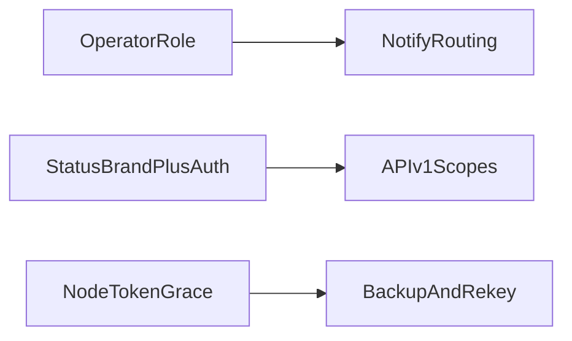

# GoUp – Verbesserungsroadmap (A+C)

**Datum:** 2026-11-11  
**Fokus:** Produktfeatures über die frühe SPEC hinaus (A) und Security/Ops-Hardening (C)  
**Nicht enthalten:** reines Engineering (PR-CI, JS-e2e, httpserver-Split) — Schwerpunkt B

---

## 1. Ausgangslage

GoUp ist funktional deutlich weiter als die frühe Zielarchitektur in [architecture.md](architecture.md) (MVP / Phase 1–3). Bereits vorhanden unter anderem:

| Bereich | Ist-Zustand |
|---|---|
| Tenancy | Control-Plane + per-Tenant-SQLite, Runner-Reconcile ohne Restart |
| Auth | Control-Plane-Admin, lokale Tenant-User, OIDC, TOTP, Rollen `admin` / `operator` / `viewer` |
| Monitore | HTTPS, TCP, ICMP, SMTP, IMAP, DNS, SDNS, UDP, WHOIS, Heartbeat |
| Status | Statusseite mit Branding/Incidents/optionalem Token-Gate, Metrics-/API-Tokens |
| Ops-Features | Maintenance, Mute, Outage-Reminders, Import/Export, `goup backup` / Rekey |
| Remote Nodes | Outbound HTTPS, Bootstrap + Token-Rotation + Previous-Token-Grace, Fingerprint-Auth |
| Notifications | Email, Matrix, Webhooks, Web Push inkl. Routing/Quiet Hours |
| API | Scoped `/{slug}/api/v1` Bearer-API (`monitors:read|write`, `metrics`) |
| Security-Baseline | HMAC-Sessions, Origin/Referer, CSP, Lockouts, AES-GCM-Secrets, Netguard/SSRF |

Die Review in [review.md](review.md) und Teile von [documentation.md](documentation.md) beschreiben teils bereits umgesetzte P0–P2-Punkte (Token-Fingerprint, Body-Limits, Multi-Tenant-Maintenance, Runner-Reconcile, WS-Origin, Lockout-Sweeper). **Tier 1 (T1.1–T1.6) ist umgesetzt**; Abschnitte unten bleiben als Spezifikation der gelieferten Arbeit. Offener Fokus: Tier 2/3.

---

## 2. Tier 1 (umgesetzt)

Tier 1 baut auf bestehendem Code auf und liefert den höchsten Hebel für Produkt und Betriebsicherheit.

### T1.1 Operator-Rolle (RBAC-Zwischenstufe)

| | |
|---|---|
| **Severity** | High (Produkt) |
| **Ist** | Nur `admin` / `viewer`; Schreibzugriff über `requireAdminWhenAuth` / `requireUserManagement` in `internal/httpserver/auth_middleware.go`. Rollen-Normalisierung in `internal/store/sqlite/control_plane_memberships.go`. |
| **Soll** | Neue Rolle `operator` (oder `editor`): CRUD für Monitore, Gruppen, Maintenance, Mute, Check-now. **Nicht** erlaubt: User-Verwaltung, OIDC-Provider, API-Tokens, Webhooks, Remote-Node-Bootstrap/Key-Rotation. `admin` bleibt für Trust-Boundary-Settings. |
| **Warum** | Multi-User-Tenants erzwingen sonst Overprivilege; Viewer können praktisch nichts operativ tun. |
| **Anker** | `auth_middleware.go`, `routes.go`, `UpdateTenantUserRole`, Settings-/Monitor-Handler |

### T1.2 Notification-Routing + Quiet Hours

| | |
|---|---|
| **Severity** | High (Produkt) |
| **Ist** | Mute (`MutedUntil`), Reminders (`RemindEveryMinutes`), Push-Kategorie-Prefs. Email/Matrix gehen an alle Tenant-Admins; Webhooks sind tenant-global. Fan-out in `internal/monitor/dispatch.go`. |
| **Soll** | Pro Notification-Endpoint: Filter auf Gruppen und/oder Monitor-IDs, optionales Severity-Set (`down` / `degraded` / `recovery` / `reminder`), Quiet Hours (unterdrücken oder verzögern). Auswahl vor Dispatcher-Fan-out. |
| **Warum** | Kanäle sind da; ohne Routing skaliert Alarm-Noise mit der Monitorzahl. |
| **Anker** | `dispatch.go`, `internal/notify/*`, Store für Endpoints/Settings, Settings-UI |

### T1.3 Status-Page Branding + Incident-Historie (+ Security)

| | |
|---|---|
| **Severity** | High (Produkt) / Medium (Security) |
| **Ist** | Settings nur `enabled` / `title` / `description` + Monitor-Auswahl (`status_page_store.go`). Öffentliche Seite mit Banner, Gruppen, 90-Tage-Bars, Maintenance-Hinweisen. Incidents werden bereits geschrieben (`dispatch.go`). Metrics-Tokens separat, ohne Expiry. |
| **Soll (Produkt)** | Logo-Upload, Markenfarbe, optional GoUp-Footer ausblenden; öffentliche Incident-Liste aus vorhandenen Incident-Daten. |
| **Soll (Security)** | Optionale Token-/Basic-Auth oder unlisted Path für interne Tenants; Metrics-Token-Expiry (+ Rotate neben bestehendem Revoke). Optional `X-Robots-Tag: noindex`. |
| **Warum** | Statusseite ist die externe Fläche; ohne Branding/Historie schwach gegenüber Wettbewerb. Ohne Access-Gate ist Uptime über den slug weltweit lesbar. |
| **Anker** | `status_page.go`, `status_page_store.go`, `settings_status_page.go`, Templates, `api_token_store.go` |

### T1.4 Scoped `/api/v1` für Automation

| | |
|---|---|
| **Severity** | High (Produkt) |
| **Ist** | Session-HTML-Forms, JSON-Import/Export (`monitor_import_export.go`), Prometheus `/{slug}/metrics` mit Scope `metrics`, öffentlicher Heartbeat `/hb/{slug}/{token}`. Kein versioniertes REST-API. |
| **Soll** | Bearer-Tokens mit Scopes (`monitors:read`, `monitors:write`, `metrics`, später `status:read`). Endpunkte unter `/api/v1/...`: Monitor-CRUD, Incidents/Results listen, Check-now. DTOs an Import-Record-Shape anlehnen. Token-UI (heute unter Status-Page-Settings) um Scopes erweitern statt zweiten Auth-Pfad. |
| **Warum** | Architecture.md flaggte stabile API-Versionierung; Automation ohne SSR-Scraping ist Standarderwartung. |
| **Anker** | `api_token_store.go`, `monitor_import_export.go`, `metrics.go`, Settings-Status-Page-Token-UI |

### T1.5 Remote-Node Token-Grace + Failed-Auth-Limits

| | |
|---|---|
| **Severity** | High (Ops/Security) |
| **Ist** | Kurzlebige Tokens, Rotation bei Poll, Fingerprint-Lookup (`remote_node_store_auth.go`). Bootstrap-Lockout vorhanden; fehlgeschlagene Bearer-Auth auf `/node/poll` und `/node/report` ohne eigenes Rate-Limit. Rotation überschreibt Ciphertext sofort. |
| **Soll** | Previous-Token-Grace-Window nach Rotation (verlorene Poll-Antwort erzwingt sonst Re-Bootstrap). Rate-Limit für fehlgeschlagene Bearer-Auth auf Poll/Report (Muster aus `rate_limits.go` / Bootstrap-Attempts). mTLS bleibt Folgeprojekt (Tier 3), kein Blocker. |
| **Warum** | Verfügbarkeit privater Checks + Missbrauchswiderstand auf zentralen Node-Endpunkten. |
| **Anker** | `remote_node_store_auth.go`, `remote_node_api_handlers.go`, `rate_limits.go`, `security_state.go` |

### T1.6 Online-Backup + Secret-Rekey

| | |
|---|---|
| **Severity** | High (Ops/Security) |
| **Ist** | README empfiehlt Dateikopie inkl. WAL; kein Tool/API. Secrets AES-GCM (`control_plane_secrets.go`) mit Primary-Key + Fallback-Decrypt; kein Re-Encrypt-Workflow zum sicheren Retire eines alten Keys. |
| **Soll** | `goup backup` und/oder Admin-Aktion: SQLite Backup API / `VACUUM INTO` für `controlplane.db` und alle Tenant-DBs; optional Retention unter `/data/backups`. Admin/CLI „re-encrypt all secrets“ unter neuem Key, danach Fallback entfernen. Explizite Previous-Key-Env dokumentieren (nicht nur stiller Session-Key-Fallback). |
| **Warum** | Live-Kopie von WAL-DBs ist fehleranfällig; Key-Rotation ohne Rekey ist unvollständig. Architecture versprach „Backup-Grundlagen“. |
| **Anker** | `cmd/goup`, `internal/store/sqlite`, `control_plane_secrets.go`, Admin-System-UI |

---

## 3. Tier 2 — Competitive Parity / Ops-Komfort (**umgesetzt**)

| ID | Thema | Severity | Kernidee | Status |
|---|---|---|---|---|
| T2.1 | HTTPS-Assertions | Medium | Method/Headers/Body, JSONPath, TLS-only-Check | done |
| T2.2 | Remote-Node UX | Medium | Online-Badge, Offline-Warnung, Bulk-Reassign, Node-Filter | done |
| T2.3 | Reports / SLA | Medium | Uptime/Incidents/MTTR + CSV-Export | done |
| T2.4 | Maintenance TZ / Monthly | Medium | IANA-TZ, monatliche Recurrence, .ics, Announce-Lead | done |
| T2.5 | Status-Subscriptions | Medium | Atom/RSS-Feed + E-Mail Double-Opt-in | done |
| T2.6 | Webhook-Secret-Rotate | Medium | Server-generiertes Secret + Dual-Secret-Grace | done |
| T2.7 | Deep Health + Audit-Retention | Medium | `/readyz`, Audit-Prune/Export | done |
| T2.8 | Docker Remote-Node Harden | Medium | Compose: `cap_drop` / `read_only` / tmpfs | done |
| T2.9 | SSRF Align | Medium | Webhook-URL-Validierung via netguard | done |

Offener Fokus danach: **Tier 3** (u. a. Remote-Node-mTLS).

---

## 4. Tier 3 — bewusst später / spekulative Kosten

| Thema | Begründung |
|---|---|
| **mTLS für Remote Nodes** | Explizit geplant in [remote-node/README.md](../remote-node/README.md); optionale Client-Certs, CA-Env, Verify auf `/node/*`. Hoher Ops-Aufwand; nach Token-Grace (T1.5). |
| gRPC-Health / Prometheus-Query-Monitore | Höhere Dependencies; widerspricht stdlib-first in architecture.md |
| Browser/Script-Checks (Playwright) | RAM/Prozess-Kosten kollidieren mit Single-Process-Ziel |
| Process-Level-Metrics, JSON-Logs, Request-IDs | Nützlich für große Installationen; nicht blocker für Self-Host-MVP-Plus |
| Status Custom Domain / Custom CSS | Nach Branding-MVP (T1.3) |
| Persistente Lockouts über Restarts | Nur relevant bei Multi-Replica; heute Single-Process-Annahme |
| Hash-only Access-Tokens / Bootstrap-Fingerprints | Defense-in-depth nach Grace + Rate-Limits |
| VAPID-Key-Rotation-UX | Create-once heute; Rotation braucht Re-Subscribe-Guidance |

---

## 5. Bewusst nicht in dieser Roadmap

- Wiederholung bereits umgesetzter Review-P0/P1/P2 als offene Bugs (Fingerprint-Auth, Body-Limits, Multi-Tenant-Maintenance, Runner-Reconcile, WS-Origin, Lockout-Sweeper, Request-Logging-Status).
- Engineering-only: PR-CI-Workflow, Race/Coverage-Gates, JS/e2e-Tests, weitere httpserver-Dateisplits, i18n-Key-Parity-CI (Schwerpunkt B).
- Feature-Implementierung der Tier-1-Items in diesem Dokumentationsschritt.

---

## 6. Bezug zu bestehenden Docs

| Dokument | Rolle |
|---|---|
| [architecture.md](architecture.md) | Frühe Zielarchitektur / Phasenplan — historisch, Ist-Zustand überholt |
| [documentation.md](documentation.md) | Umfassende Code-/Architektur-Review (2026-04); Backlog teils veraltet |
| [review.md](review.md) | First-pass Security/Runtime-Review inkl. später umgesetzter Fixes |
| **Dieses Dokument** | Aktuelle priorisierte A+C-Roadmap (2026-11) |

---

## 7. README-Roadmap-Spiegel

Kurzform für die öffentliche README (siehe auch Root-[README.md](../README.md)):

- [x] Public status page *(inkl. Branding / Incident-Historie / optionale Auth — T1.3)*
- [x] Additional monitor types *(HTTPS-Assertions T2.1)*
- [x] Operator role and finer permissions *(T1.1)*
- [x] Notification routing and quiet hours *(T1.2)*
- [x] Versioned JSON API (`/api/v1`) *(T1.4)*
- [x] Remote-node token grace *(T1.5)*; mTLS bleibt Tier 3
- [x] Online backup and secret rekey *(T1.6)*
- [x] Tier 2 parity/ops items *(T2.1–T2.9)*
